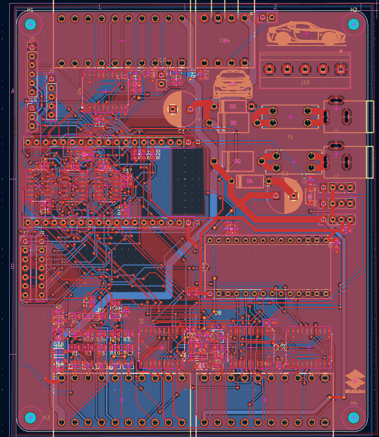
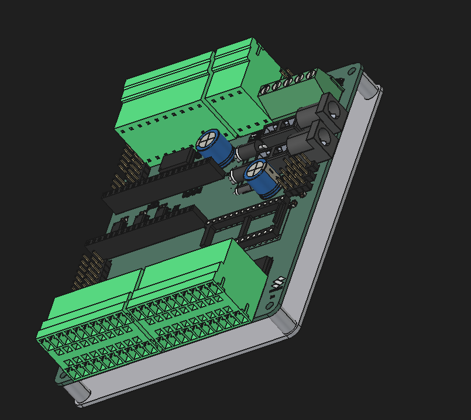
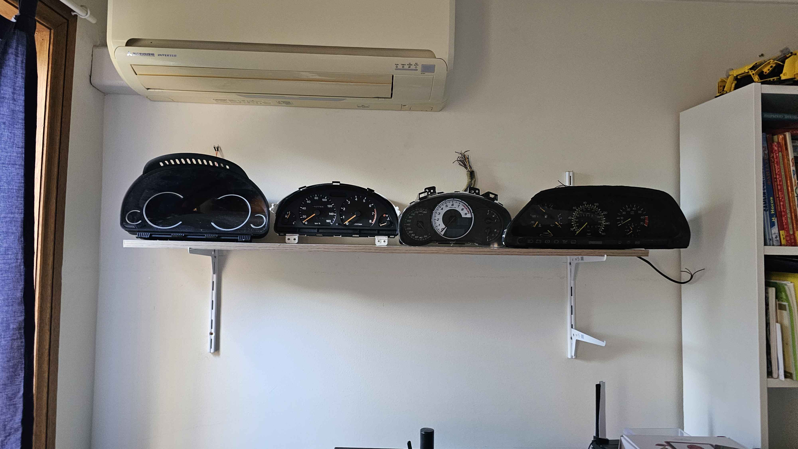
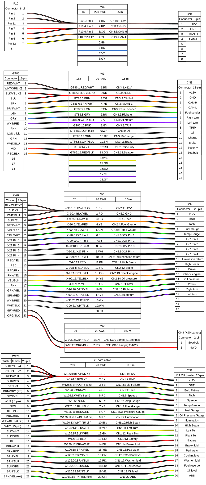

# Multi-Cluster-Control
One PCB that controls 7 real car instrument clusters independently, from 1980s analogue gauges requiring AC, to modern CAN-bus dashboards, all running independently from a single ESP32.

# Why I made this
I made this project mostly because I had a lot of car dashboards around, and wanted to use them independently! This would include things such as simply showing time, CPU/GPU temp, HDD write speed, and other things that traditionally take up a spot on the screen. However, it will not be limited to this, as I am also planning on connecting them to racing games like Trackmania Nations Forever, BeamNG (not a racing game), and others. Other than that, I suppose this would just be a fun project. It includes PCB making and a lot of wiring (each cluster has around 20 wires), so I thought it'd be cool, and so far it has been.

# Pictures

# BOM

| Section | Item | Designators / use | Part # / search term | Supplier | Qty | Unit price (USD) | Line total (USD) | Price status | Link | Notes |
|---|---|---|---|---|---|---|---|---|---|---|
| PCB + assembly | Multi-Cluster-Control PCB, 5 boards, 2 assembled (Economic PCBA, 1 oz, top side) | Whole board, all JLC-placed parts | Gerbers + BOM + CPL from Fabrication Toolkit | JLCPCB | 1 | $65.70 | $65.70 | Quoted | [link](https://jlcpcb.com) | PCB $9.80 + PCBA $55.90 |
| PCB + assembly | JLCPCB coupon |  |  | JLCPCB | 1 | -$10.00 | -$10.00 | Quoted |  |  |
| PCB + assembly | Keystone 3568 mini-blade fuse holder (idle parts) | F1, F2 (2 boards) | C5249699 | JLCPCB parts cart | 4 | $1.21 | $4.84 | Quoted | [link](https://jlcpcb.com/partdetail/C5249699) | Idle parts |
| Board parts not assembled by JLC | Cluster plug, 10-pin 3.81 mm screw (KANGNEX WJ15EDGK-3.81-10P-14-00A) | CN1-CN3, 2 per header | C26865 | LCSC | 6 | $0.8112 | $4.87 | Quoted | [link](https://www.lcsc.com/product-detail/C26865.html) |  |
| Board parts not assembled by JLC | Cluster plug, 4-pin 3.81 mm screw (KANGNEX WJ15EDGK-3.81-04P-14-00A) | CN4, 2 per header | C7244 (min order 5) | LCSC | 5 | $0.3082 | $1.54 | Quoted | [link](https://www.lcsc.com/product-detail/C7244.html) | Min order 5 |
| Board parts not assembled by JLC | 5-way screw terminal, 5.08 mm (Phoenix MKDS 1,5/5-5,08, 1715750) | J15 | C6042418 | LCSC | 2 | $1.2721 | $2.54 | Quoted | [link](https://www.lcsc.com/product-detail/C6042418.html) | 1 spare |
| Board parts not assembled by JLC | 1x14 female header 2.54 mm | J11 (VID6606 adapter), 2 per board | C2905420 (min order 5) | LCSC | 5 | $0.1580 | $0.79 | Quoted | [link](https://www.lcsc.com/product-detail/C2905420.html) | Min order 5 |
| Modules and chips | VID6606 stepper driver, SOP-28 (5 pcs) | X-90 speedo stepper driver | VID6606 | AliExpress | 1 | $4.61 | $4.61 | Quoted | [link](https://www.aliexpress.com/item/1005007323081013.html) |  |
| Modules and chips | SOP-28 to DIP-28 adapter boards (10 pcs) | Carrier for the VID6606 in J11 | SOP28 to DIP28 | AliExpress | 1 | $1.73 | $1.73 | Quoted | [link](https://www.aliexpress.com/item/32909339596.html) | 15.24 mm DIP width |
| Modules and chips | X27.168 gauge stepper motor | X-90 speedo + 1 spare | X27.168 | AliExpress | 2 | $2.35 | $4.70 | Quoted | [link](https://www.aliexpress.com/item/1005006620561935.html) |  |
| Modules and chips | PCA9685 16-ch PWM module | J5/J6 (gauge PWM) | PCA9685 | AliExpress | 1 | $3.79 | $3.79 | Quoted | [link](https://www.aliexpress.com/item/1005005670283526.html) |  |
| Modules and chips | MCP2515 CAN module, TJA1050, 8 MHz | Second CAN module | MCP2515 TJA1050 | AliExpress | 1 | $0.92 | $0.92 | Quoted | [link](https://www.aliexpress.com/item/1005010199935143.html) | 8 MHz crystal |
| Modules and chips | MP1584EN adjustable buck module (5 pcs) | M5 (5.0 V), M6 (3.6 V) | MP1584EN | AliExpress | 1 | $3.15 | $3.15 | Quoted | [link](https://www.aliexpress.com/item/1005007653423578.html) | Set voltage before soldering |
| Modules and chips | MT3608 boost module | M7 (24 V) | MT3608 / 1PCS | AliExpress | 1 | $2.38 | $2.38 | Quoted | [link](https://www.aliexpress.com/item/1005011548818999.html) | Set to 24 V |
| Wiring | 20-core 20 AWG RVV sheathed cable, 2 m | 4 cluster cables x 0.5 m | RVV 20 core 20 AWG, 2 m option | AliExpress | 1 | $18.73 | $18.73 | Quoted | [link](https://www.aliexpress.com/item/1005004200589656.html) |  |
| Wiring | Dupont jumpers, female-female, 10 cm, 40 pcs | PCA9685, MCP2515 x2, light sensor | Dupont F-F 10 cm | AliExpress | 1 | $0.99 | $0.99 | Quoted | [link](https://www.aliexpress.com/item/1005009372155336.html) |  |
| Power | 12 V 4 A plug pack, 5.5 x 2.1 mm, AU plug | J1, J2 | 4A/12 V/AU Plug | AliExpress | 2 | $4.19 | $8.38 | Quoted | [link](https://www.aliexpress.com/item/1005013455261196.html) | Centre-positive |
| Power | SCA mini blade fuse 5 A, 6 pack | F1, F2 + spares | 726696 | Supercheap Auto | 1 | $2.81 | $2.81 | Quoted | [link](https://www.supercheapauto.com.au/p/sca-sca-automotive-fuses-mini-blade-5-amp-6-pack/726696.html) | Click & collect |
| Lighting | T10 (W5W) LED wedge bulbs, 6500K white, 10 pack | Cluster illumination | ASIN B0HGLD6KBJ | Amazon AU | 1 | $6.33 | $6.33 | Quoted | [link](https://www.amazon.com.au/dp/B0HGLD6KBJ) | Polarised |
| Mounting | M3 x 16 mm pan head screws + M3 nuts | Board to support, 4 holes | M3 x 16 machine screws + nuts | Bunnings | 1 | $3.52 | $3.52 | Estimate |  |  |
| Discounts | AliExpress checkout discounts |  |  | AliExpress | 1 | -$4.34 | -$4.34 | Quoted |  |  |
| Already owned | ESP32 dev board (38-pin) | J3/J4 |  | Owned | 1 | $0.00 | $0.00 | Owned |  |  |
| Already owned | Light sensor module | J14 |  | Owned | 1 | $0.00 | $0.00 | Owned |  |  |
| Already owned | MCP2515 CAN module (first one) | J7 or J9 |  | Owned | 1 | $0.00 | $0.00 | Owned |  |  |
| Shipping | Shipping: DHL Express (PCB + assembly + idle parts) |  |  | JLCPCB | 1 | $18.11 | $18.11 | Quoted |  |  |
| Shipping | Shipping: Global Direct Standard Line |  |  | LCSC | 1 | $9.93 | $9.93 | Quoted |  |  |
| Shipping | Shipping: Handling fee |  |  | LCSC | 1 | $3.00 | $3.00 | Quoted |  | Waived over $15.55 merchandise |
| Shipping | Shipping: Dupont jumper store |  |  | AliExpress | 1 | $3.08 | $3.08 | Quoted |  |  |
| Shipping | Shipping: MCP2515 store |  |  | AliExpress | 1 | $2.27 | $2.27 | Quoted |  |  |
| Shipping | Shipping: All other items |  |  | AliExpress | 1 | $0.00 | $0.00 | Quoted |  | Free shipping |
| Shipping | Shipping: Click & collect |  |  | Supercheap Auto | 1 | $0.00 | $0.00 | Quoted |  |  |
| Shipping | Shipping: Standard delivery (T10 bulbs) |  |  | Amazon AU | 1 | $0.00 | $0.00 | Estimate |  | Free over AU$49 |
| Total | Parts (after discounts) |  |  |  |  |  | $127.98 |  |  |  |
| Total | Shipping |  |  |  |  |  | $36.39 |  |  |  |
| **Total** | **TOTAL** |  |  |  |  |  | **$164.37** |  |  |  |
